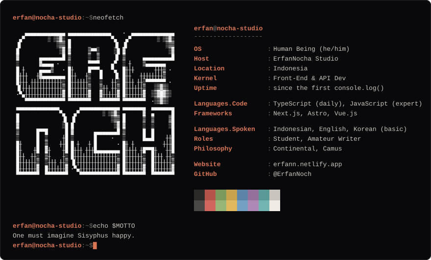
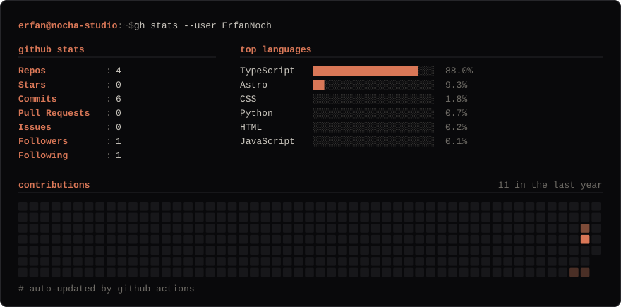

<picture>
  <source media="(max-width: 640px)" srcset="./assets/neofetch-mobile.svg">
  
</picture>

<picture>
  <source media="(max-width: 640px)" srcset="./assets/stats-mobile.svg">
  
</picture>

<!-- Optional plain-text links, add yours:
[website](https://erfann.netlify.app/) · [email](mailto:YOUR_EMAIL) · [linkedin](https://linkedin.com/in/YOUR_ID) · discord: YOUR_HANDLE
-->
